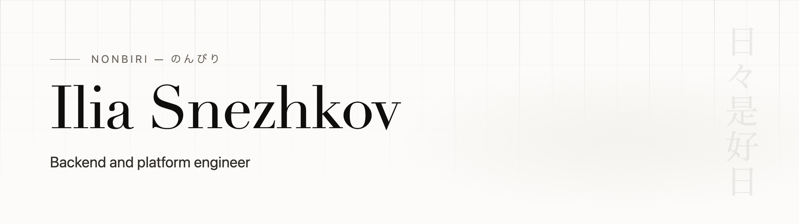

<a href="https://nonbiri.dev">
  <picture>
    <source media="(prefers-color-scheme: dark)" srcset="assets/header-dark.png">
    
  </picture>
</a>

### MindOne

Linux 6.18 and LineageOS 24 (Android 17) for the iKKO MindOne (MediaTek Helio G99) — an
independent port, made without vendor support.

- **[android_kernel_ikko_mindone](https://github.com/iasnezhkov/android_kernel_ikko_mindone)** —
  device modules and DTB over Google's android17-6.18 GKI, forward-ported from the stock 5.10
  through 6.1 and 6.12.
- **[android_device_ikko_mindone](https://github.com/iasnezhkov/android_device_ikko_mindone)** —
  the LineageOS 24 device tree, with its own AIDL audio, sensors, GNSS and camera services.

### Japan

- **[sudachi-swift](https://github.com/iasnezhkov/sudachi-swift)** — Swift bindings for
  [Sudachi](https://github.com/WorksApplications/sudachi.rs), the Japanese morphological
  analyzer: on-device tokenization for iOS and macOS.
- **[Gokaku 合格](https://nonbiri.dev/gokaku)** — an offline trainer for Japan's written
  driving exam, on the [App Store](https://apps.apple.com/app/id6799978043).
- **[Suji 筋](https://nonbiri.dev/suji)** — an iPad app for studying Japanese, in development.

---

[nonbiri.dev](https://nonbiri.dev) · <a href="https://nonbiri.dev/ja" lang="ja">日本語</a> ·
[LinkedIn](https://linkedin.com/in/iasnezhkov) · [site source](https://github.com/iasnezhkov/nonbiri)
